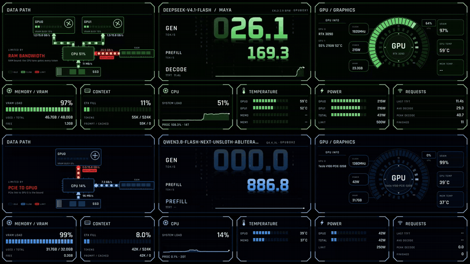

# llm-wayvisuals

Sci-fi 1920x480 "sensor panel" displays for LLM inference servers, fed by the
live stats export of [llm-visuals](https://github.com/DingoOz/llm-visuals).
Linux only; works on Wayland (GNOME, KDE, sway, Hyprland, ...) and on X11.
CPU rendering, no GPU needed on the display machine.



<sub>Two servers in one window: a DeepSeek MoE on 2x RTX 3090 limited by RAM
bandwidth (experts on the CPU lane), and a Qwen model on a V100 limited by
PCIe. Full capture: [docs/media/capture.mp4](docs/media/capture.mp4) ·
still: [docs/media/screenshot.png](docs/media/screenshot.png).</sub>

Each panel shows:

- **Generation and prefill rates** in large digits, each with a small MAX
  block on its right (session peak from the export, or the highest value seen
  by this client since start when the export has none), phase, TTFT, and a
  decode-rate curve.
- **Data path**: SSD → CPU/RAM → up to 4 GPUs, with live throughput on every
  link (disk, RAM weight stream, PCIe per GPU). The link that holds the model
  back glows red, using llm-visuals' own bottleneck verdict.
- **GPU**: aggregate utilisation, clock, power and VRAM across the model's
  GPUs, plus one line per GPU.
- **CPU**: host load over the last 15 s, and the inference process load
  normalised over the engine's compute threads.
- Memory/VRAM, context fill, temperatures, power, and the last request.

A panel without fresh data shows NO SIGNAL, never old values as current ones.

## Build

Rust (stable, edition 2021). No development packages are needed: winit loads
the display libraries at run time. At run time you need the libraries of your
session:

- Fedora: `libwayland-client libxkbcommon libxkbcommon-x11 libX11 libXcursor libXi libxcb`
- Debian/Ubuntu: `libwayland-client0 libxkbcommon0 libxkbcommon-x11-0 libx11-6 libxcursor1 libxi6 libx11-xcb1 libxcb1`

```
cargo build --release
./target/release/llm-wayvisuals --help
```

## Usage

```
# local file written by llm-visuals --export-json
llm-wayvisuals --server /run/user/1000/llmv-0.json,output=DP-2

# Unix socket (NDJSON)
llm-wayvisuals --server unix:///run/user/1000/llmv-0.sock,output=DP-3,theme=blue

# remote daemon over HTTP with a bearer token (keep the file at mode 0600)
llm-wayvisuals --server http://gpubox1.example.lan:9464,token-file=~/.config/llm-wayvisuals/gpubox1.token

# three panels
llm-wayvisuals --server /run/user/1000/llmv-0.json,output=DP-2 \
               --server unix:///run/user/1000/llmv-1.sock,output=DP-3 \
               --server http://host:9464,model=deepseek,title=Maya
```

## GPU rendering

Panels can be drawn with OpenGL (femtovg on a GL 3.3 core or GLES 3.0 context;
EGL on Wayland, GLX/EGL on X11) instead of the CPU. The `gpu` cargo feature is
on by default; `cargo build --release --no-default-features` builds the pure
CPU client with no GL code or dependency.

```
llm-wayvisuals --renderer auto|gpu|cpu ...      # default: auto, or $LLMV_RENDERER
```

- `auto`: per surface (window or monitor), GPU when a *hardware* GL context can
  be created, otherwise that surface falls back to the CPU path. Software
  renderers (llvmpipe, softpipe, swrast, lavapipe, Microsoft Basic Render) are
  rejected on purpose.
- `gpu`: same, but an error when unavailable. `cpu`: the tiny-skia path.
- One stderr line per surface says which one runs, e.g.
  `surface 1: renderer: gpu (AMD Radeon Graphics (radeonsi, ...), GL 4.6)` or
  `surface 1: renderer: cpu (reason)`.
- The GPU path redraws all bands every frame (no damage tracking) and swaps
  with swap interval 0: frames are paced by the application (`--fps`).
  `LLMV_PROFILE=1` reports `gl submit` and `gl swap` for it.
- Note: the CPU path is incremental (damage based) and its CPU use is already
  low, so the GPU path is not necessarily cheaper in CPU terms (see the
  profiler on your machine).
- `render-png --renderer gpu` and `bench-render --renderer gpu` use a headless
  (surfaceless EGL) context. `compare-renderers` renders every fixture with both
  backends and checks the differences (PSNR >= 35 dB, <= 1 % of the pixels off
  by more than 16); side-by-side PNGs of failures are written to `--out`.

## Stacking

One surface (a window, or a fullscreen monitor) shows 1 to 3 panels stacked
vertically. Panels are grouped by `output`: all panels without `output` share
one surface, panels with the same `output` share that monitor, and different
outputs give different surfaces.

```
# one window with 3 stacked panels (1920x1080 by default)
llm-wayvisuals --window --server A.json --server B.json --server C.json

# two screens, one panel each
llm-wayvisuals --server A.json,output=DP-2 --server B.json,output=DP-3

# three panels stacked on one screen
llm-wayvisuals --server A.json,output=DP-2 --server B.json,output=DP-2 --server C.json,output=DP-2
```

In a surface of W x H: one panel keeps its native 4:1 shape (W x W/4,
centred); two or three panels fill the surface, each W x H/n. Three real
1920x480 screens still work: give each panel its own `output`.

`--server` keys: `output`, `theme` (green, gold, purple, blue), `model`
(`auto`, a pid, or part of a name), `token-file` (http only), `name`, `title`.
https is not supported: use a VPN or `ssh -L` and point to `http://127.0.0.1:PORT`.

Without `--server`, the config file is read (`--config PATH`, else
`~/.config/llm-wayvisuals/config.toml`). See
[config.example.toml](config.example.toml). `--server` overrides the file.

- `--list-outputs` prints the monitors (index, name, size, position, refresh,
  scale) and exits.
- **Name outputs by connector (`DP-2`), not by index.** Indexes are not the
  same on Wayland and on X11. A name that is not found falls back to a normal
  window, with a message listing the available outputs.
- `--window` opens normal decorated windows, one per group (development, 1920x1080 by default, scaled down to fit the screen).
- Keys in a panel window: `Esc` or `q` quits, `F` toggles fullscreen for the whole surface.
- Frame rate: `--fps` (default 30) while a model is in prefill or decode,
  `--idle-fps` (default 15) when all live panels are idle, 2 fps when no panel
  has been live for 10 s.
- The window title, app id and WM_CLASS are `llm-wayvisuals`, for compositor
  rules.
- Logs go to stderr, prefixed `llm-wayvisuals:`. SIGINT/SIGTERM exit cleanly.

Other subcommands: `render-png --input FILE.json --out OUT.png` (draw a panel
without a display), `bench-render`.

## Exporter (llm-visuals)

The panels read the live export added to llm-visuals in
[Pix13/llm-visuals, branch `feature/live-export`](https://github.com/Pix13/llm-visuals/tree/feature/live-export)
(proposed upstream). With an export flag, llm-visuals runs as a headless
daemon next to the inference server:

```
llm-visuals --export-json /run/user/1000/llmv-0.json          # file
llm-visuals --export-sock /run/user/1000/llmv-0.sock          # Unix socket
llm-visuals --export-listen 0.0.0.0:9464                      # HTTP, LAN
llm-visuals --export-listen 0.0.0.0:9464 --export-token-file ~/.t   # HTTP + token
llm-visuals --demo --export-json /tmp/demo.json               # no GPU needed
```

That branch also has a systemd user unit (`contrib/systemd/`) and the JSON
schema (`llm-visuals.stats/1`, `docs/export-schema.md`).

## Demo without a GPU

`tools/demo3.sh` starts three `llm-visuals --demo` daemons and shows them in
one window (it needs `llm-visuals` from the branch above in `PATH`, or set
`LLM_VISUALS=/path/to/llm-visuals`).

## License

MIT (see [LICENSE](LICENSE)). Fonts: Rajdhani and Oxanium, SIL Open Font
License 1.1 (`assets/fonts/*/OFL.txt`).
